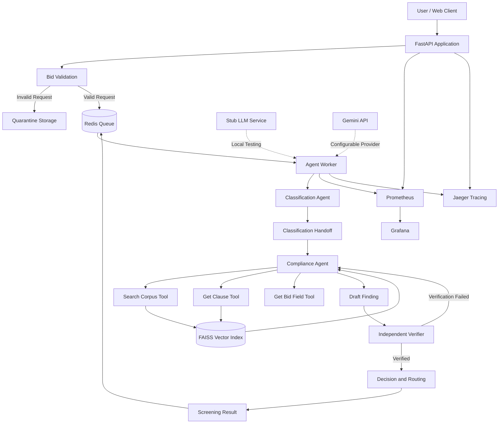

# Public Procurement Bid Compliance Screening Service

A multi-agent, LLM-powered bid compliance screening system that evaluates submitted bid summaries against tender requirements and applicable government procurement policies.

The system uses LangGraph, Retrieval-Augmented Generation (RAG), FAISS, FastAPI, Redis, Docker Compose, Prometheus, Grafana and OpenTelemetry.

**Important:** This system produces evidence-backed screening findings. It does not independently reject or qualify a bidder. The final decision belongs to the tender committee.

---

## 1. Project Overview

Public procurement departments receive bids from different organisations in response to published tenders. Before technical evaluation begins, every bid must be checked against mandatory eligibility requirements.

These requirements can include:

- Minimum annual turnover.
- Previous work experience.
- Earnest Money Deposit (EMD).
- EMD exemption eligibility.
- Mandatory document submission.
- Startup and Micro and Small Enterprise (MSE) relaxations.
- Applicable government procurement policies.

A major challenge is that tender documents and government procurement policies may contain different or modifying requirements.

For example, a tender may specify a minimum turnover requirement, while a government policy may permit eligible startups to receive relaxation from prior turnover and experience conditions.

A system that searches only the tender document can therefore produce an incorrect screening result.

This project addresses that problem using multiple agents, agent-selected retrieval, policy-aware reasoning and independent citation verification.

### Main objectives

1. Accept bid summaries through a REST API.
2. Validate incoming bid data before agent execution.
3. Classify the bidder.
4. Retrieve relevant tender clauses and government policies.
5. Evaluate each mandatory compliance condition.
6. Verify findings against retrieved source passages.
7. Produce one of the supported screening routes.
8. Escalate cases when evidence is insufficient or authoritative provisions conflict.
9. Monitor execution through metrics, logs and distributed tracing.

---

## 2. System Architecture

The application runs locally using Docker Compose.

### Architecture diagram



### Agent responsibilities

| Agent | Responsibility |
|---|---|
| Classification Agent | Identifies bidder category and extracts relevant qualification entities. |
| Compliance Agent | Investigates mandatory requirements, calls retrieval tools and produces a draft finding. |
| Verification Agent | Independently checks findings and citations against retrieved passages. |
| Routing logic | Determines the appropriate screening route or escalation path after verification. |

The agents are orchestrated using LangGraph and communicate through typed graph state and explicit hand-offs.

### Retrieval tools

The compliance agent has three main tools:

**1. Search Corpus**

Searches relevant tender clauses, government orders and procurement policies using semantic retrieval.

**2. Get Clause**

Retrieves a specific clause or paragraph using a document ID and clause reference.

**3. Get Bid Field**

Retrieves relevant fields from the submitted bid summary.

The agent decides which tools to call based on the information it needs.

### Verification

The verifier checks:

- Whether citations resolve to passages retrieved during the current run.
- Whether the quoted text matches the retrieved passage.
- Whether mandatory conditions have supporting evidence.
- Whether the proposed route is consistent with the compliance findings.
- Whether the output contains unsupported or unsafe determinations.

If verification fails, the compliance agent can retry with additional retrieval. If the finding still cannot be verified, the system escalates it to a human.

---

## 3. Technology Stack

| Component | Technology |
|---|---|
| Programming language | Python 3.11 |
| Agent orchestration | LangGraph |
| LLM provider | Google Gemini / Local Stub LLM |
| API framework | FastAPI |
| Retrieval framework | LangChain Community |
| Vector database | FAISS |
| Embedding model | Sentence Transformers – all-MiniLM-L6-v2 |
| Queue and cache | Redis |
| Containerisation | Docker and Docker Compose |
| Monitoring | Prometheus |
| Dashboard | Grafana |
| Distributed tracing | OpenTelemetry and Jaeger |
| Load testing | Locust |
| Testing | Pytest |

The embedding model runs locally inside the worker container. It does not require a paid embedding API.

---

## 4. Repository Structure

```text
mlops_bid_project/
│
├── contracts/
│   └── bid_summary.schema.json
│
├── corpus/
│   ├── manifest.json
│   └── text/
│       └── Procurement policy and tender source text
│
├── docs/
│   ├── PLAN.md
│   ├── REPORT.md
│   ├── RUNBOOK.md
│   ├── INCIDENT_LOG.md
│   ├── LLMOPS.md
│   ├── PHASE3_RESULTS.md
│   └── corpus_confirmation.md
│
├── eval/
│   ├── bidders.json
│   ├── scenarios.py
│   ├── run.py
│   └── compare.py
│
├── load/
│   └── locustfile.py
│
├── observability/
│   ├── prometheus.yml
│   ├── grafana-dashboard.json
│   └── grafana-provisioning.yaml
│
├── pipeline/
│   ├── chunking.py
│   ├── embeddings.py
│   └── ingest.py
│
├── prompts/
│   ├── classifier/
│   ├── compliance/
│   └── verifier/
│
├── services/
│   ├── api/
│   │   ├── app/
│   │   │   ├── main.py
│   │   │   └── static/
│   │   │       └── index.html
│   │   ├── requirements.txt
│   │   └── Dockerfile
│   │
│   ├── worker/
│   │   ├── worker/
│   │   │   ├── main.py
│   │   │   ├── agents.py
│   │   │   ├── retrieval.py
│   │   │   └── verifier.py
│   │   ├── requirements.txt
│   │   └── Dockerfile
│   │
│   ├── common/
│   │   ├── config.py
│   │   ├── contract.py
│   │   ├── llm.py
│   │   ├── models.py
│   │   ├── prompts.py
│   │   ├── runstore.py
│   │   ├── safety.py
│   │   └── tracing.py
│   │
│   └── stub_llm/
│       └── main.py
│
├── tests/
│
├── artifacts/
│
├── docker-compose.yml
├── Makefile
├── .env.example
├── .gitignore
└── README.md
```

Runtime index files, Redis data, quarantine records and run records are stored in Docker-managed volumes. Load-test and evaluation artefacts are written under `artifacts/`.

---

## 5. Requirements for a New PC

You do not need to install Python, Redis, FAISS, Grafana or the embedding model separately on the host PC. These dependencies are handled by Docker.

Install:

| Software | Requirement |
|---|---|
| Git | Required to clone the repository |
| Docker Desktop | Required on Windows and macOS |
| Docker Compose V2 | Included with current Docker Desktop |
| Linux Docker Engine | Docker Compose plugin required |
| Internet connection | Required for initial image builds and dependency/model downloads |

A Python installation is optional for running the Docker application. Python 3 is useful for some standalone testing commands.

### Download links

- Docker Desktop: https://www.docker.com/products/docker-desktop/
- Git: https://git-scm.com/downloads
- Python: https://www.python.org/downloads/

On Windows, ensure Docker Desktop is running before executing the commands below.

---

## 6. Setup Instructions – Run on Another PC

### Step 1: Clone the GitHub repository

Open Terminal, Command Prompt, PowerShell or Git Bash.

```bash
git clone https://github.com/abhi1207-chugh/mlops_bid_project.git
```

Move into the project directory:

```bash
cd mlops_bid_project
```

### Step 2: Create the environment file

Copy the example configuration:

**macOS / Linux / Git Bash**

```bash
cp .env.example .env
```

**Windows PowerShell**

```powershell
Copy-Item .env.example .env
```

The `.env` file contains machine-specific configuration. It should not be uploaded to GitHub.

### Step 3: Configure the environment

Open `.env` in VS Code or another text editor.

For the first run, use the default Stub LLM configuration.

Make sure these values are present:

```env
LLM_PROVIDER=stub
LLM_API_KEY=
LLM_BASE_URL=http://stub-llm:8080
LLM_MODEL=
```

Set a non-empty Grafana password:

```env
GRAFANA_ADMIN_USER=admin
GRAFANA_ADMIN_PASSWORD=CHANGE_TO_A_STRONG_PASSWORD
```

Keep the host ports at their defaults initially:

```env
API_PORT=8000
GRAFANA_PORT=3000
```

The rest of the configuration can remain as provided in `.env.example`.

**Important:** The Grafana password is required by Docker Compose. Do not leave it blank.

### Step 4: Start Docker Desktop

Open Docker Desktop and wait until the Docker Engine reports that it is running.

Check the installation:

```bash
docker --version
docker compose version
```

### Step 5: Build and start the complete application

From the project root:

```bash
docker compose up --build -d
```

This command builds the API, worker and stub LLM images, then starts the application and supporting infrastructure.

The first build can take some time because the worker image installs dependencies and downloads the local Sentence Transformer embedding model.

You need an internet connection during the initial build.

### Step 6: Check container status

```bash
docker compose ps
```

The application contains these services:

| Container / Service | Purpose |
|---|---|
| api | FastAPI backend and web client |
| worker | LangGraph agent execution |
| redis | Queue, cache and run storage |
| stub-llm | Local model substitute for testing |
| prometheus | Metrics collection |
| grafana | Monitoring dashboard |
| jaeger | Distributed tracing |

Redis and the Stub LLM have health checks. The API and worker also expose health/readiness endpoints.

### Step 7: Verify application health

Open:

```text
http://localhost:8000/health
```

The response should resemble:

```json
{
  "status": "ok",
  "redis": true,
  "index": {
    "built": true,
    "age_seconds": 10.0,
    "chunks": 245
  },
  "queue": {
    "queued": 0,
    "processing": 0
  }
}
```

The number of chunks and index age can differ.

The worker builds the FAISS index on its first startup if one does not already exist.

You can also inspect worker startup:

```bash
docker compose logs --tail=100 worker
```

Look for:

```text
worker_ready
```

### Step 8: Open the web application

Open:

http://localhost:8000

The Bid Compliance Screening interface should appear.

Select a sample bidder from the dropdown. The sample JSON will be populated automatically.

Click **Submit for screening**.

The browser submits the request, polls its status and displays the final finding with citations and any committee escalation questions.

The current web sample endpoint exposes B1–B12. The formal evaluation runner expands the set to 20 scenarios using `eval/scenarios.py`.

---

## 7. Optional: Configure Google Gemini

The application supports Gemini through the provider interface in `services/common/llm.py`.

The Stub LLM is recommended for repeatable local setup and evaluation. Gemini is used for real model-powered screening.

To enable Gemini, open `.env` and update:

```env
LLM_PROVIDER=gemini
LLM_API_KEY=YOUR_GOOGLE_GEMINI_API_KEY
LLM_BASE_URL=https://generativelanguage.googleapis.com
LLM_MODEL=gemini-3.5-flash-lite
```

Keep the other timeout, retry and agent configuration values unchanged initially.

Get an API key from:

https://aistudio.google.com/api-keys

The configured Gemini request uses the `generateContent` API.

**Important configuration detail:** Set `LLM_BASE_URL` explicitly when using Gemini. Docker Compose has a fallback to `http://stub-llm:8080` when the variable is empty.

Recreate the worker to load the new configuration:

```bash
docker compose up -d --force-recreate worker
```

Verify the selected provider and model without printing the API key:

```bash
docker compose exec worker sh -lc '
echo "LLM_PROVIDER=$LLM_PROVIDER"
echo "LLM_BASE_URL=$LLM_BASE_URL"
echo "LLM_MODEL=$LLM_MODEL"
if [ -n "$LLM_API_KEY" ]; then
  echo "LLM_API_KEY=SET"
else
  echo "LLM_API_KEY=MISSING"
fi
'
```

Check worker logs:

```bash
docker compose logs -f worker
```

A successful model request should show an HTTP 200 response.

Gemini free-tier availability and rate limits depend on the provider. HTTP 429 and 503 responses may occur. The system uses bounded retries and safe escalation when the model cannot be reached.

Never commit a real API key or share it in screenshots.

---

## 8. Accessing the Application and Monitoring Tools

With default ports:

| Service | URL |
|---|---|
| Bid Compliance Web Application | http://localhost:8000 |
| API Health | http://localhost:8000/health |
| API Readiness | http://localhost:8000/ready |
| Prometheus | http://localhost:9090 |
| Grafana | http://localhost:3000 |
| Jaeger | http://localhost:16686 |

### Grafana login

Use the username and password configured in `.env`.

Default username:

```text
admin
```

Password: the value you entered for `GRAFANA_ADMIN_PASSWORD`.

The dashboard is provisioned from:

```text
observability/grafana-dashboard.json
```

It includes panels for run latency, p50/p95, throughput, route counts, agent success, verification, retries, retrieval cache, queue depth, feedback, cost and worker uptime.

### Prometheus

Open:

http://localhost:9090

Navigate to:

```text
Status → Targets
```

Check that the available API, worker and Stub LLM targets are being scraped.

### Jaeger

Open:

http://localhost:16686

Search for services such as:

```text
bid-compliance-api
bid-compliance-worker
```

A run ID can be used to inspect the corresponding trace and reconstruct execution.

---

## 9. Running a Bid Screening Through the API

The web interface is the easiest way to submit a sample.

The REST API can also be used directly.

### Submit a screening

Endpoint:

```http
POST /v1/screenings
```

Example using the B2 sample from the API:

```bash
curl -s http://localhost:8000/v1/samples \
| python3 -c 'import json,sys; print(json.dumps(next(x["bid"] for x in json.load(sys.stdin) if x["id"]=="B2")))' \
| curl -s -X POST http://localhost:8000/v1/screenings \
    -H "Content-Type: application/json" \
    --data-binary @-
```

A successful submission returns a run identifier:

```json
{
  "run_id": "YOUR-RUN-ID",
  "status": "queued",
  "flags": []
}
```

### Check screening status

```http
GET /v1/screenings/{run_id}
```

Example:

```bash
curl -s http://localhost:8000/v1/screenings/YOUR-RUN-ID \
| python3 -m json.tool
```

The request returns the current run status and, after completion, the screening finding.

### Retrieve the complete execution trace

```http
GET /v1/screenings/{run_id}/trace
```

Example:

```bash
curl -s http://localhost:8000/v1/screenings/YOUR-RUN-ID/trace \
| python3 -m json.tool
```

The trace includes the bid, recorded agent/tool activity and usage information available for that run.

### Submit committee feedback

```http
POST /v1/screenings/{run_id}/feedback
```

Example:

```bash
curl -X POST http://localhost:8000/v1/screenings/YOUR-RUN-ID/feedback \
  -H "Content-Type: application/json" \
  -d '{"satisfactory":true,"reason":"Reviewed by committee"}'
```

### Retrieve feedback summary

```http
GET /v1/feedback/summary
```

The endpoint returns aggregated persisted feedback.

---

## 10. API Endpoints

| Method | Endpoint | Purpose |
|---|---|---|
| GET | `/` | Web client |
| GET | `/health` | Service health and index status |
| GET | `/ready` | API readiness |
| GET | `/v1/samples` | Sample bid data |
| POST | `/v1/screenings` | Validate and enqueue a screening |
| GET | `/v1/screenings/{run_id}` | Retrieve run status and finding |
| GET | `/v1/screenings/{run_id}/trace` | Retrieve execution trace |
| POST | `/v1/screenings/{run_id}/feedback` | Submit committee feedback |
| GET | `/v1/feedback/summary` | Feedback aggregation |
| GET | `/metrics` | Prometheus metrics |

A valid screening request is accepted asynchronously. The API returns a run ID instead of waiting for the agents to finish.

Invalid requests are quarantined at the API boundary and do not start an agent run.

---

## 11. Corpus and Document Retrieval

The retrieval pipeline uses a local corpus of public procurement documents.

The selected corpus includes:

- NIT Rourkela tender NITR/PW/CIC-LTE/2026/390.
- Department of Expenditure order dated 25 July 2016.
- Department of Expenditure order dated 20 September 2016.
- MSME procurement policy circular.
- General Financial Rules 2017, Chapter 6.
- Other supporting procurement-policy documents recorded in the corpus manifest.

The tender is a published, closed tender. Bidder records used in testing are synthetic; no real bidder data is used.

The corpus manifest is:

```text
corpus/manifest.json
```

Source and tender confirmation details are documented in:

```text
docs/corpus_confirmation.md
```

### Chunking and embeddings

The pipeline uses clause-aware chunking to preserve tender clause identifiers and policy references.

Embeddings are generated locally using:

```text
sentence-transformers/all-MiniLM-L6-v2
```

The resulting vectors are indexed in FAISS.

### Rebuild or update the index

Run:

```bash
make ingest
```

Or directly:

```bash
docker compose run --rm worker python -m pipeline.ingest
```

The ingestion process is idempotent and content-hashed. Unchanged source files can reuse their cached embeddings.

To force re-embedding:

```bash
docker compose run --rm worker python -m pipeline.ingest --force
```

Do not force a rebuild unless the embedding model or source documents require it.

---

## 12. Evaluation – 20 Scenarios

The project includes a fixed evaluation set of at least 20 scenarios.

The original bidder inputs are stored in:

```text
eval/bidders.json
```

The evaluation expansion is implemented in:

```text
eval/scenarios.py
```

The evaluation runner constructs B1–B20, including the required difficult case from Section 4.1.

### Scenario coverage

| Scenario | Description |
|---|---|
| B1 | DPIIT startup, low turnover and no experience |
| B2 | Compliant large enterprise |
| B3 | Large enterprise with low turnover |
| B4 | Missing OEM authorisation and data sheet |
| B5 | Turnover certificate does not cover three years |
| B6 | MSE trader claims EMD exemption |
| B7 | MSE with low turnover |
| B8 | Startup claimed without DPIIT certificate |
| B9 | Consortium bidder |
| B10 | Foreign bidder |
| B11 | Prompt injection in remarks |
| B12 | Malformed request with negative turnover and unknown category |
| B13–B20 | Generated evaluation variants of B1–B8 |

B13–B20 are reproducible variants generated by `eval/scenarios.py`; they are not eight entirely independent new input designs.

### Run the evaluation suite

Install GNU Make if it is not already available on your host.

Run:

```bash
make eval
```

The evaluation runs the 20 scenarios against prompt version v1 and then v2 using the Stub LLM.

The generated files are:

```text
artifacts/eval-v1.json
artifacts/eval-v2.json
artifacts/eval-prompt-comparison.json
```

The runner reports:

- Route accuracy.
- Groundedness.
- Context relevance.
- Faithfulness.
- Hallucination rate.

The evaluation process returns a non-zero exit status if the actual routes do not match the expected routes.

Inspect failed scenarios instead of changing expected routes merely to make the evaluation pass.

### Metric definitions

| Metric | Measurement |
|---|---|
| Groundedness | Share of evaluated findings that pass independent verification |
| Context relevance | Share of findings citing at least one expected supporting passage |
| Faithfulness | Share of findings that pass verification and provide citations for conditions containing evidence |
| Hallucination rate | One minus faithfulness |

Invalid/quarantined requests are excluded from retrieval-quality denominators because they should never reach the model.

These are deterministic evaluation proxies, not claims of human-reviewed legal correctness.

---

## 13. Testing

Run the automated test suite:

```bash
make test
```

Or directly:

```bash
docker compose run --rm worker pytest -q tests
```

The tests cover areas such as:

- Bid contract validation.
- Invalid and malformed request quarantine.
- Prompt injection protection.
- API asynchronous submission.
- Rate limiting.
- Agent workflow.
- Citation verification.
- Document chunking.
- LLM retries and circuit breaker.
- Redis run-store behaviour.
- Worker recovery.

After making code changes, rerun the tests before pushing them to GitHub.

---

## 14. Load Testing and Worker Scaling

The project uses Locust to measure system performance with a local Stub LLM.

This avoids using Gemini API capacity as the benchmark bottleneck.

### Run the normal load test

```bash
make load
```

This starts a two-minute test with 20 Locust users.

### Compare one worker and three workers

```bash
make scale-benchmark
```

The benchmark:

1. Starts the system with one worker.
2. Runs the Locust workload.
3. Saves the one-worker results.
4. Restarts the worker service with three replicas.
5. Runs the same workload again.
6. Saves the three-worker results.

The output CSV files are written under:

```text
artifacts/
```

Expected filenames include:

```text
load-worker1_stats.csv
load-worker1_stats_history.csv
load-worker1_failures.csv

load-worker3_stats.csv
load-worker3_stats_history.csv
load-worker3_failures.csv
```

The precise generated filenames depend on the Locust output.

The full-screening measurement must be taken from submission through polling to the terminal result, not from the API acceptance response alone.

### Scaling manually

To start three worker replicas:

```bash
docker compose up -d --scale worker=3 worker
```

Check:

```bash
docker compose ps
```

The worker service has no fixed container name or host port, allowing multiple replicas.

### Recorded benchmark

The repository's measurement report records a 20-user, two-minute Stub LLM comparison:

| Measurement | One worker | Three workers |
|---|---:|---:|
| Completed screenings | 272 | 830 |
| Completed screenings/sec | 2.29 | 7.00 |
| p50 | 270 ms | 270 ms |
| p95 | 71 s | 530 ms |
| Locust failures | 0 | 0 |
| 30-second complete-run p95 SLO | Not met | Met |

The recorded throughput improvement was approximately 3.06×.

The main identified bottleneck was the single worker's sequential processing and queue accumulation.

These are previously recorded measurements, not guaranteed results on every machine. Re-run the benchmark on the target PC before reporting local measurements.

Detailed protocol:

```text
docs/PHASE3_RESULTS.md
```

---

## 15. Environment Configuration Reference

All environment-specific configuration belongs in `.env`.

Do not store actual API keys, passwords or machine-specific credentials in tracked source files.

| Variable | Purpose |
|---|---|
| `LLM_PROVIDER` | Selects `stub` or `gemini` |
| `LLM_API_KEY` | Provider API key |
| `LLM_BASE_URL` | Provider base URL |
| `LLM_MODEL` | Model identifier |
| `LLM_TIMEOUT_SECONDS` | LLM request timeout |
| `LLM_MAX_RETRIES` | Maximum retries |
| `CIRCUIT_BREAKER_FAILURE_THRESHOLD` | Failures before circuit opens |
| `CIRCUIT_BREAKER_RESET_SECONDS` | Circuit reset delay |
| `LLM_PRICE_PROMPT_PER_1K` | Prompt-token price for cost tracking |
| `LLM_PRICE_COMPLETION_PER_1K` | Completion-token price for cost tracking |
| `STUB_DELAY_MS` | Artificial delay in Stub LLM |
| `AGENT_MAX_STEPS` | Maximum agent LLM steps per run |
| `AGENT_MAX_TOOL_CALLS` | Maximum tool calls per run |
| `AGENT_MAX_SECONDS` | Maximum agent execution time |
| `TOOL_TIMEOUT_SECONDS` | Retrieval/tool timeout |
| `EMBEDDING_MODEL` | Local embedding model |
| `INDEX_DIR` | Index storage directory |
| `CORPUS_DIR` | Corpus directory |
| `REDIS_URL` | Redis connection URL |
| `QUARANTINE_DIR` | Invalid request storage |
| `RUN_STORE_DIR` | Run storage directory |
| `OTEL_EXPORTER_OTLP_ENDPOINT` | OpenTelemetry collector endpoint |
| `RATE_LIMIT_PER_MINUTE` | Per-client API rate limit |
| `RETRIEVAL_CACHE_SECONDS` | Retrieval cache lifetime |
| `AUTO_SCORE_SAMPLE_RATE` | Fraction of live runs sampled for automatic scoring |
| `PROMPT_VERSION` | Active prompt version |
| `API_PORT` | Host port for the API |
| `GRAFANA_PORT` | Host port for Grafana |
| `GRAFANA_ADMIN_USER` | Grafana username |
| `GRAFANA_ADMIN_PASSWORD` | Grafana password |

The full variable list and default values are maintained in `.env.example`.

---

## 16. Troubleshooting

### Problem 1: Docker command cannot connect to the daemon

**Symptom**

Docker Compose cannot start containers.

**Check**

```bash
docker info
```

**Recovery**

Start Docker Desktop and wait until the Docker Engine is running.

### Problem 2: Port already in use

**Symptom**

Docker reports that a port is already allocated or the address is already in use.

**Recovery**

Change the host port in `.env`.

For example:

```env
API_PORT=8001
GRAFANA_PORT=3002
```

Restart:

```bash
docker compose up -d
```

Open the application at the new configured port.

Changing the host port does not change the container's internal port.

### Problem 3: Redis is unavailable

**Symptom**

The health endpoint reports Redis as unavailable or screening requests return 503.

**Check**

```bash
docker compose ps redis
docker compose logs redis
```

**Recovery**

```bash
docker compose restart redis api worker
```

Requests that were not accepted must be submitted again.

### Problem 4: Gemini API returns 503 or 429

**Symptom**

Worker logs contain:

```text
HTTP/1.1 503 Service Unavailable
```

or:

```text
HTTP/1.1 429 Too Many Requests
```

**Check**

```bash
docker compose logs --tail=100 worker
```

**Recovery**

Check provider availability and quota. The client retries with exponential backoff and opens its circuit breaker after repeated failed calls.

For local testing, switch to Stub mode in `.env`:

```env
LLM_PROVIDER=stub
LLM_API_KEY=
LLM_BASE_URL=http://stub-llm:8080
LLM_MODEL=
```

Recreate the worker:

```bash
docker compose up -d --force-recreate worker
```

### Problem 5: Gemini requests are sent to Stub LLM

**Symptom**

Worker logs show requests to:

```text
http://stub-llm:8080/v1/generate
```

even though Gemini was intended.

**Check**

```bash
docker compose exec worker sh -lc '
echo "LLM_PROVIDER=$LLM_PROVIDER"
echo "LLM_BASE_URL=$LLM_BASE_URL"
echo "LLM_MODEL=$LLM_MODEL"
'
```

**Recovery**

For Gemini, set an explicit base URL:

```env
LLM_PROVIDER=gemini
LLM_BASE_URL=https://generativelanguage.googleapis.com
```

Recreate the worker:

```bash
docker compose up -d --force-recreate worker
```

### Problem 6: FAISS index is missing or retrieval fails

**Check**

```bash
curl http://localhost:8000/health
```

Inspect worker logs:

```bash
docker compose logs --tail=100 worker
```

**Recovery**

```bash
make ingest
```

Then restart the workers:

```bash
docker compose up -d --force-recreate worker
```

### Problem 7: A run remains in processing

**Check**

```bash
docker compose logs worker
```

Check run status:

```text
GET /v1/screenings/{run_id}
```

Workers recover stale processing entries after the configured recovery interval. Restart a worker if necessary.

### Problem 8: Jaeger trace is missing

**Check**

```bash
docker compose ps jaeger
docker compose logs api worker
```

Confirm:

```env
OTEL_EXPORTER_OTLP_ENDPOINT=http://jaeger:4317
```

Submit a new screening and search for the API or worker service in Jaeger.

For additional recovery procedures, see:

```text
docs/RUNBOOK.md
docs/INCIDENT_LOG.md
```

---

## 17. Useful Docker Commands

| Command | Purpose |
|---|---|
| `docker compose up --build -d` | Build and start all services |
| `docker compose ps` | Check service status |
| `docker compose logs -f` | Follow all service logs |
| `docker compose logs -f worker` | Follow worker logs |
| `docker compose restart worker` | Restart workers |
| `docker compose up -d --force-recreate worker` | Recreate workers with updated environment |
| `docker compose down` | Stop and remove containers and network |
| `docker compose down -v` | Remove containers and named volumes |
| `docker compose up -d --scale worker=3 worker` | Start three worker replicas |

**Warning:** `docker compose down -v` deletes the named application and Redis data volumes, including persisted run and queue data. Use it only when you intentionally want to reset local state.

For a normal shutdown, use:

```bash
docker compose down
```

---

## 18. Security and Operational Notes

- Never commit `.env` or real API keys.
- Use `.env.example` as the safe configuration template.
- Keep API keys in runtime environment variables.
- Invalid requests are quarantined before agent execution.
- All model-generated findings must pass citation verification.
- The system escalates rather than returning unverified findings.
- The Stub LLM is intended for development, testing and load benchmarking. It is not a production reasoning model.
- Gemini API usage may incur cost depending on the account and provider pricing.
- Configure token prices in `.env` if cost telemetry is required.
- The embedding model runs locally; no paid embedding service is required.
- Use a published, closed tender. Do not screen bids against a live tender.
- This is a screening support tool, not a legal opinion or an autonomous tender decision-maker.

---

## 19. Additional Documentation

| Document | Description |
|---|---|
| `docs/PLAN.md` | Development plan and requirement mapping |
| `docs/REPORT.md` | Project report and architecture |
| `docs/RUNBOOK.md` | Operational recovery procedures |
| `docs/INCIDENT_LOG.md` | Development incident history |
| `docs/LLMOPS.md` | Prompt, evaluation, guardrail, cost and feedback details |
| `docs/PHASE3_RESULTS.md` | SLO, evaluation and load-testing results |
| `docs/corpus_confirmation.md` | Tender and policy corpus details |

---


## Repository

GitHub: https://github.com/abhi1207-chugh/mlops_bid_project
