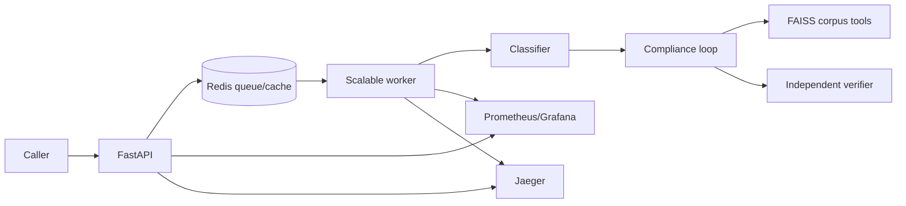

# Project Report

## Scope

This service screens public-procurement bids using tender clauses and modifying policy. It issues cited findings only; the tender committee decides. B1, the required DPIIT startup case, escalates because the tender lacks the policy-required relaxation provision.

## Architecture

The API validates and quarantines invalid payloads. The worker runs three independent LangGraph role nodes with explicit hand-offs: the classifier produces only category/entity state; the compliance agent alone may invoke corpus and bid tools and produces a draft; the verifier receives that draft plus the run-local retrieved passages, but has no retrieval tool. The hand-off is a typed graph state, not prompt text between roles. A role failure, an invalid hand-off, tool timeout, loop-budget exhaustion, or verification failure follows the same safe terminal path: an escalation, never a confident finding. Tools are corpus search, clause lookup, and bid-field lookup. The loop is bounded by steps, calls, per-tool timeouts, and wall-clock time.

## Design choices

Agent-selected retrieval can follow tender clauses into policy. Every citation resolves against passages retrieved in that run. Redis caches only raw retrieval passages, then records them in the current run; caching completed findings would violate citation rules. The stub makes measurements reproducible, while Gemini stays behind the provider client.

## Measurements

`make eval` runs the 20-case L3 benchmark with the deterministic stub to validate batch execution and metric/report generation. Because the stub uses hard-coded Python routing and citation logic, its output is not evidence of prompt quality. `make eval-live` runs the paired prompt experiment against the configured Gemini provider, changing only the compliance prompt (v1 to v2) while keeping classifier and verifier at v1. It records route accuracy, groundedness, context relevance, faithfulness, hallucination rate, scenario fingerprint, and prompt configuration in `artifacts/eval-live-*.json`. This may consume provider quota or incur charges according to the configured account. `make load` uses the local stub. `make scale-benchmark` writes Docker-generated Locust CSV files for one and three workers to `artifacts/`; use these to record the scaling effect. The SLO is p95 API acceptance under 250 ms and stub completed screening under 30 seconds. Grafana exposes p50/p95 run and per-agent step latency, per-agent task success rate, steps/tool calls, retries, availability, worker uptime, cost, and cache ratio.

Verified evidence: 44 Docker tests passed. Gemini returned HTTP 200 for classifier, compliance, and verifier calls; B1 completed as escalation and B2 as pass. Observed individual Gemini calls were about 0.9–16.3 seconds. A 20-user, two-minute stub Locust comparison measured complete screenings (submission through terminal polling): one worker completed 2.29 screenings/s at p95 71 s, which missed the 30-second complete-run SLO due to queueing; three workers completed 7.00 screenings/s at p95 530 ms, meeting it. This is a 3.06× throughput improvement; raw CSV evidence is retained in `artifacts/` and the method/results are in `PHASE3_RESULTS.md`.

Cost per 100 runs is `100 × sum(screening_llm_cost_total) / sum(screening_runs_total)` after a representative test. Provider calls dominate single-run latency; worker scaling improves queued throughput.

## Incidents and limitation

Docker Desktop pause and occupied host ports were resolved and logged in `INCIDENT_LOG.md`. An early measurement command inherited Gemini from `.env`; explicit Compose worker overrides now support stub measurements. The corpus uses the updated tender version that closed on 08-Nov-2026.
