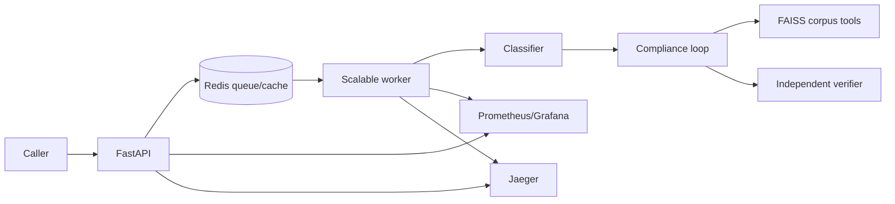

# Project Report

## Scope

This service screens public-procurement bids using tender clauses and modifying policy. It issues cited findings only; the tender committee decides. B1, the required DPIIT startup case, escalates because the tender lacks the policy-required relaxation provision.

## Architecture

The API validates and quarantines invalid payloads. The worker runs classifier, tool-using compliance agent, and separate verifier. Tools are corpus search, clause lookup, and bid-field lookup. The loop is bounded by steps, calls, and time. Failure or unverifiable citations escalates.

## Design choices

Agent-selected retrieval can follow tender clauses into policy. Every citation resolves against passages retrieved in that run. Redis caches only raw retrieval passages, then records them in the current run; caching completed findings would violate citation rules. The stub makes measurements reproducible, while Gemini stays behind the provider client.

## Measurements

`make eval` runs 20 cases including B1 on v1 and v2, reporting route accuracy, groundedness, context relevance, faithfulness, and hallucination rate. `make load` uses the local stub. The SLO is p95 API acceptance under 250 ms and stub completed screening under 30 seconds. Grafana exposes latency, throughput, error rate, availability, retries, agent activity, cost, and cache ratio.

Verified evidence: 43 Docker tests passed. Gemini returned HTTP 200 for classifier, compliance, and verifier calls; B1 completed as escalation and B2 as pass. Observed individual Gemini calls were about 0.9–16.3 seconds. Attach actual `make eval`, Locust CSV, and one-versus-three-worker dashboard captures for final submission; no benchmark figures are claimed before those runs.

Cost per 100 runs is `100 × sum(screening_llm_cost_total) / sum(screening_runs_total)` after a representative test. Provider calls dominate single-run latency; worker scaling improves queued throughput.

## Incidents and limitation

Docker Desktop pause and occupied host ports were resolved and logged in `INCIDENT_LOG.md`. An early measurement command inherited Gemini from `.env`; explicit Compose worker overrides now support stub measurements. The corpus uses the updated tender version that closed on 08-Nov-2026.
